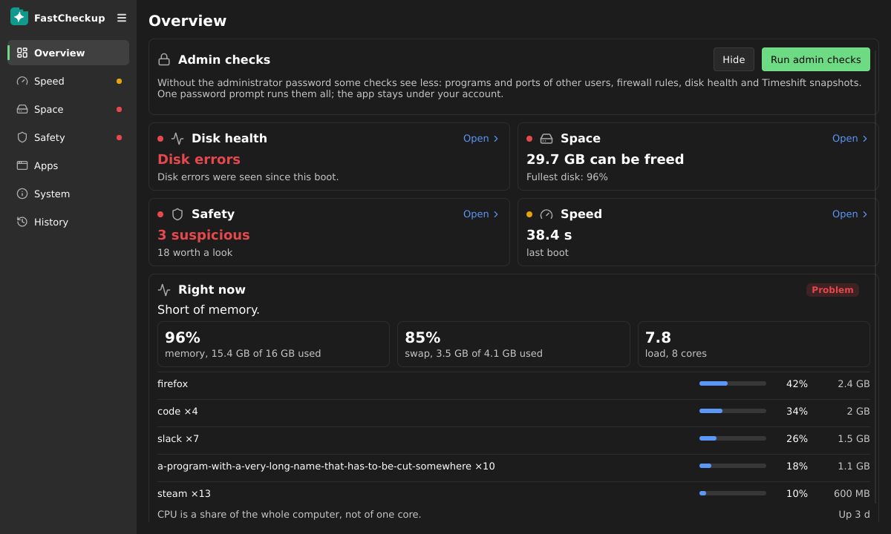
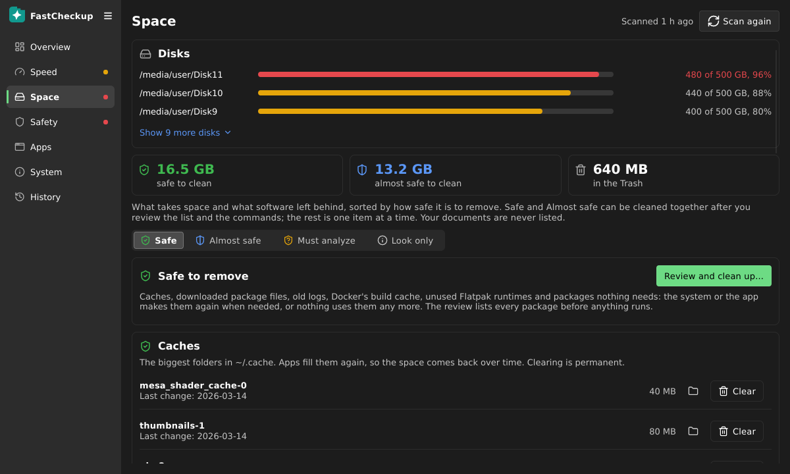
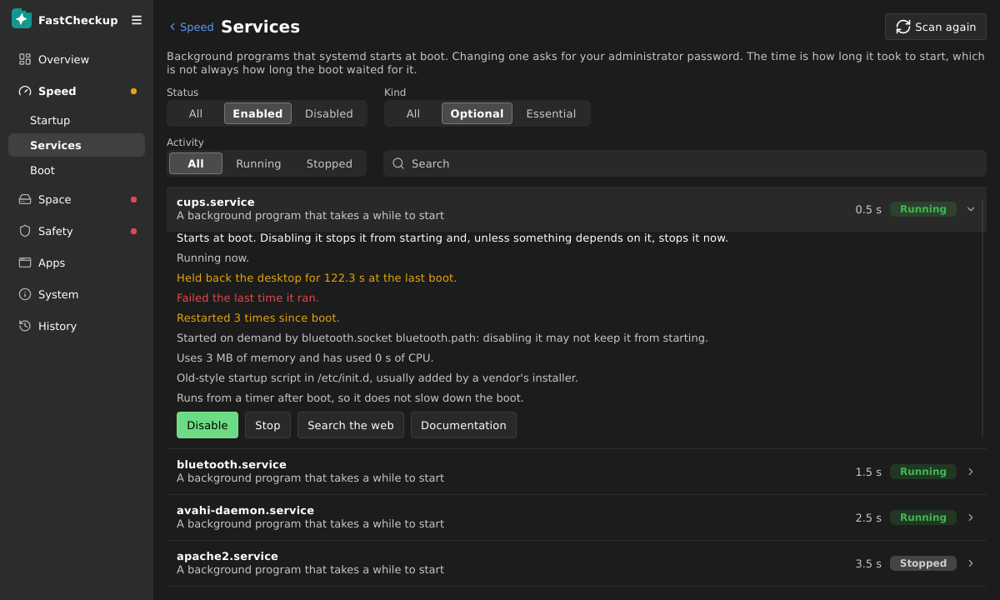
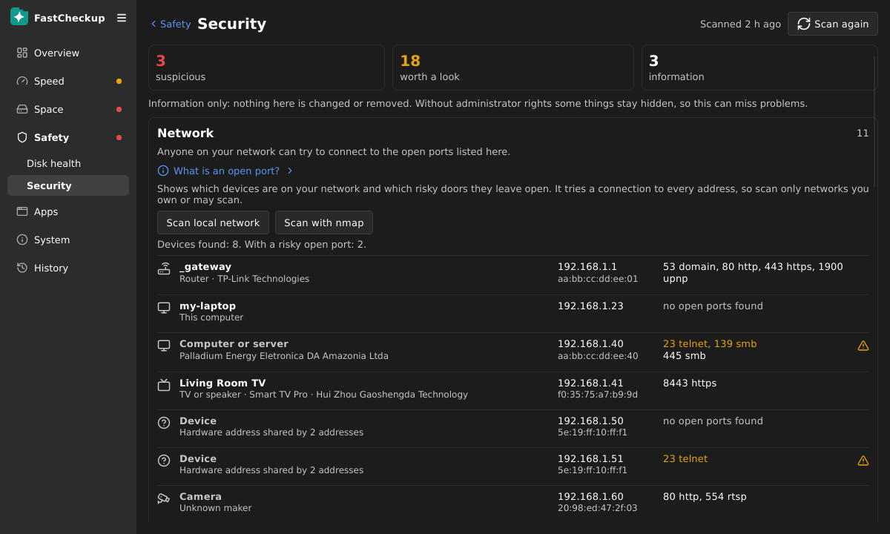
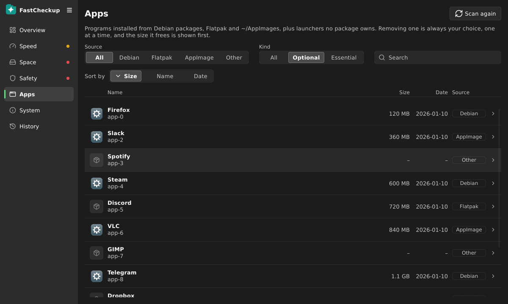

#  FastCheckup

A light and fast Linux app that **shows what is slow, large, unused or exposed** on your computer, and lets you act on
each item one at a time. It never cleans everything in one click. Built with Rust + Slint. GPL-3.0-or-later.



<details>
<summary>More screenshots</summary>






</details>

_Screenshots use sample data._

## What it shows

- **Overview**: One card per area with its status, plus a **Right now** check of memory, swap, load and the busiest apps.
- **Speed**: **Startup**: turn login apps on or off. **Services**: enable or disable background services, with their start time and, in the opened row, what helps you decide: which package installed it (or none), whether it held the desktop back, what starts it on demand, memory and CPU in use, failures and restarts, and its documentation, plus a button that searches the web for what a service is. **Boot**: where boot time goes and the GRUB menu timeout. Also a check that something protects you when memory runs out.
- **Space**: the disks and one clean-up page, sorted by how safe it is to remove. **Safe**: caches, Flatpak app caches (`~/.var/app/<app>/cache` only, one row per app, refused while the app runs), browser caches (cache, crash reports and Chrome's on-device AI models for Chrome, Chromium, Brave and Firefox; logins, cookies, tabs and history are never touched, and a browser that is open is refused), Python `__pycache__` folders (one row per project, `.pyc`-only folders outside hidden folders), package files, old logs, crash dumps in `/var/lib/systemd/coredump` (one `pkexec` delete), Docker's build cache, unused Flatpak runtimes, packages nothing needs. **Almost safe**: Cargo downloads in `~/.cargo` (`registry/src`, `registry/cache`, `git`) that no build has used for the set number of days (newer ones are in Must analyze), build folders (`target`, `node_modules`, and a Python `.venv`/`venv`/`env` next to a project file), installers and Trash entries older than a set number of days, and old tool versions. **Must analyze**: recent build folders, the whole Trash, duplicate files, Docker containers, old kernels, old Timeshift snapshots (listed after **Run admin checks**; the newest 3 and those from the last 6 months are always kept, each older one is deleted through `timeshift --delete`), settings and data of removed apps, one item at a time. **Look only**: the biggest folders and files, game libraries.
  Safe and Almost safe also have **Review and clean up**: one dialog lists every item (untick what you want to keep) and can show the exact command lines before anything runs.
- **Safety**: **Disk health**: failing disks, failed mounts and SMART on request. **Security**: open ports, odd programs, things that start by themselves, risky browser add-ons and weak spots in the network you are on (open or WEP Wi-Fi, proxies, extra root certificates, SSH passwords, `/etc/hosts` redirects, one hardware address answering for several addresses, Samba/NFS shares open to everyone), each with a "checked, fine" line when it is clean. A button scans your local network for devices and risky open ports (built in, or with nmap when installed); it never runs by itself, and it refuses while the default route is a VPN or tunnel (that network is not yours to scan). If the kernel log cannot be read in time, Disk health says so instead of reporting no errors. Each device shows a name (DNS, mDNS, NetBIOS), a guess of what it is, its maker and model when known, and its open ports with the risky ones highlighted. Report only.
- **Apps**: Installed Debian, Flatpak and AppImage apps with size and "last data activity"; uninstall one. Launchers no package owns (e.g. Cisco Secure Client) are listed as "Other", report only.
- **System**: What this computer is: hardware, drivers and whether graphics acceleration works. Copy it all as text.
- **History**: Every change you made.

## How it behaves

- **Scans never change anything.** Each change is a button on one item, or a reviewed bulk clean-up of the Safe and Almost safe groups, behind a confirm dialog that shows exactly what will run, and it is logged in History. The root steps of a bulk clean-up (apt autoremove, apt clean, journal) run in one administrator prompt.
- **Reversible where possible:** files go to the Trash, services are disabled (not removed), startup entries get an override instead of an edit, and the GRUB change keeps a backup.
- **Honest wording:** it says "last data activity", never "unused", and "nothing visible looks wrong", never "your system is clean".
- **Essential system software** is marked as such and protected.
- **Private and light:** no network calls, no telemetry, about 27 MB of memory.
- **`fastcheckup --tab-system`** opens on System and skips the scans of the other pages until you open one (for shortcuts to system info). If the app is already open it switches to System.

## Install

- **`.deb`** (recommended): the password prompt says what FastCheckup is doing.
- **AppImage**: works the same, but the password prompt is generic and it does not update through `apt`.

### Flatpak (not sandboxed)

An inspector inside a sandbox only sees its own files and programs, so the app has the permission `--talk-name=org.freedesktop.Flatpak` and uses it to start itself on the host (`flatpak-spawn --host`). It can do anything you can do. Check it with `flatpak info --show-permissions io.github.evandro777.FastCheckup`.

#### Install from file (no updates)

A `.flatpak` file downloaded from Releases is a one-off install (will not auto update). To get automatic updates, go to [Install with automatic updates](#install-with-automatic-updates).

Download `FastCheckup-<version>-x86_64.flatpak` from [Releases](https://github.com/evandro777/FastCheckup/releases), then execute:

```bash
flatpak install --user ~/Downloads/FastCheckup-<version>-x86_64.flatpak
```

#### Install with automatic updates

This app is not in Flathub yet. You need to add this repository as a remote. Every release is also published as a Flatpak remote, so `flatpak update` (or your software centre) keeps the app updated.

  ```bash
  flatpak remote-add --system --if-not-exists fastcheckup https://evandro777.github.io/FastCheckup/fastcheckup.flatpakrepo
  flatpak install --system fastcheckup io.github.evandro777.FastCheckup
  ```

**`--system` vs `--user` matters for updates.** Linux Mint's Update Manager (and probably other software centres) only looks at *system-wide* Flatpaks; With `--user`, update by hand: `flatpak update --user`.

The remote is GPG-signed (system-wide installs refuse unsigned remotes), but the key lives in this same repository. It needs the Flathub remote for the runtime (`flatpak remote-add --if-not-exists flathub https://dl.flathub.org/repo/flathub.flatpakrepo`, with `--system` or `--user` to match).

The app never runs as root. Actions that need it ask for your password through `pkexec`. The Overview offers **Run admin checks**: one password prompt runs a fixed read-only script as root (`ss`, `/proc`, failed logins, `ufw status`, `smartctl`, Timeshift folders) so Security, Disk health and Timeshift show what they cannot see as your user. Nothing is changed, and the app stays under your account (relaunching a window as root would read root's settings and break on Wayland).

## Supported systems

- **Debian, Ubuntu and Linux Mint** with systemd. Tested on Mint (Cinnamon, X11); Wayland is not tested yet.
- By design it has no auto-cleaning, no background service, and never deletes your Documents, Dropbox or Pictures.
- Not yet: a command-line version, Arch and Fedora, and languages other than English and Português.

## Settings

`$XDG_DATA_HOME/FastCheckup/settings.toml` (usually `~/.local/share/FastCheckup/`), next to `history.jsonl`. The appearance
(system, light or dark) and the language are set in Preferences, from the menu button; the rest you edit by hand.

| Key              | Default | Meaning                                                                 |
|------------------|---------|-------------------------------------------------------------------------|
| `stale_months`   | `6`     | Months without data changes before an app is marked as possibly unused. |
| `usage_days`     | `90`    | "Almost safe" age in days (installers, build folders, Trash). Also in Preferences. |
| `excluded_paths` | `[]`    | Folders the build-output search never enters.                           |

## Build from source

```bash
cargo run --profile fast
```

Needs Rust 1.95 or newer (the `rust-version` in `Cargo.toml`, also checked in CI).

System deps (Debian family): `libfontconfig-dev libxkbcommon-dev libxkbcommon-x11-dev libx11-dev libxcb1-dev`.
Contributor notes are in `AGENTS.md` and `CONTRIBUTING.md`.

## Credits

The interface icons in `crates/app/ui/icons/` are from [Lucide](https://lucide.dev), under the ISC licence
(see `crates/app/ui/icons/LICENSE`).
